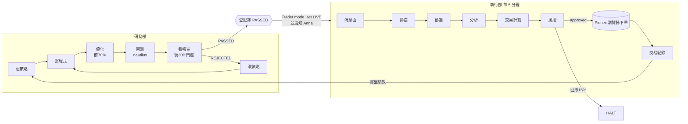

# Trader 私人交易公司（pionex-macd v2）

Grok Bot「Trader」的交易公司：**研發部**在 nautilus_trader 上研發、回測、優化短線/剝頭皮策略；**執行部**只拿通過門檻的策略，依紀律在 **Pionex（瀏覽器，不用 API）** 交易 USDT 永續（2 倍逐倉、可多可空）。所有工具透過同一個 stdio MCP 連接器 `pionex-trading-skills` 提供。

- 不持有交易所金鑰、程式不下單；下單只由 Trader 在瀏覽器裡的 Pionex 進行。
- 不使用任何 LLM 模型或付費工具；分析是純規則的多時間框架分析。
- 起始模式 **PAPER**。策略在樣本外通過全部門檻後，Trader 自行切 **LIVE** 並通知 Anna。
- 安裝：見 [INSTALL.md](INSTALL.md)（`bash bootstrap.sh`）。Trader 每輪怎麼做：見 [docs/TRADER_PLAYBOOK.md](docs/TRADER_PLAYBOOK.md)。

## 組織圖（13 個角色）

### 研發部（6 人）— `rnd/`

| 角色 | 負責 | 用的工具/程式 |
|---|---|---|
| 1. 想策略 | 從執行部紀錄與市場觀察提出假設，登記為 `idea` | `rnd_registry`、`journal/events.jsonl`、`rnd/strategies/registry.json` |
| 2. 寫程式 | 依模板把策略寫成 `rnd/strategies/<name>.py`（`signals()`、`near()`、`SPACE`） | `rnd/strategies/base.py` |
| 3. 回測 | nautilus_trader 組合層級回測（0.05% 手續費、硬性風控同實盤） | `rnd_run_backtest` → `rnd/engine.py` |
| 4. 優化 | optuna 只在前 70% 資料、少量參數、≤300 次 | `rnd/optimize.py`（`rnd_run_backtest(trials=…)`） |
| 5. 看報表 | 樣本外門檻表 PASS/FAIL、各幣種/各月份拆解 | `rnd_report` → `rnd/report.py` |
| 6. 改策略 | 依報表與實盤紀錄修改或淘汰策略（改完是新版本，要重新走完整流程；不准對樣本外調參） | `rnd_registry`、`rnd_report` |

### 執行部（7 人）— `exec/`

| 角色 | 負責 | 用的工具 |
|---|---|---|
| 7. 消息面 | 找出危險、不可交易時段（USD 高影響數據、OKX 公告），失敗即封鎖 | `news_danger_windows` |
| 8. 掃描市場 | Pionex 白名單內，依 24h 成交額選前 10–15 名，附波動率 | `market_scan` |
| 9. 篩選 | 快要觸發策略的標的 | `shortlist` |
| 10. 分析 | 規則式多時間框架分析（5m/15m/1h/4h、RSI、ATR、資金費率），提供第二意見 | `analyze_symbol` |
| 11. 交易計劃 | 只取 `tradable=true` 訊號：進場/停損/停利/數量/有效期 | `live_signals` |
| 12. 風險管控 | 硬性上限（不可放寬）：每筆 ≤0.5% 風險、日虧 3% 停新單、回撤 15% HALT、連虧 7 筆停 24h、單幣保證金 ≤10%、最多 3 倉、2x 逐倉、禁止提幣/轉帳 | `risk_check`、`risk_state` |
| 13. 交易紀錄 | 成交、權益、決策與放棄原因寫入帳本與日誌，回流研發部 | `journal_write` |

公司層級：`company_status`（總覽與自動轉實盤判斷）、`mode_get` / `mode_set`、`job_status`（背景回測進度）。

## 工作循環

## 自動轉實盤門檻（`company/live_criteria.json`）

樣本外（最後 30%，從未用於調參）必須**全部**通過：交易 ≥300 筆、扣費後獲利因子 ≥1.3、最大回撤 ≤15%、平均每筆淨利 ≥2× 來回手續費、扣掉最好的單一幣種/月份/前兩筆後淨利仍 > 0。

## 目錄

| 路徑 | 內容 |
|---|---|
| `company/` | 硬性風控、上線門檻、Pionex 合約白名單、回測標的、共用路徑與 OKX 公開資料 |
| `rnd/` | 資料下載、策略模板與種子策略、nautilus 回測、optuna 優化、報表、`strategies/registry.json`、`reports/<策略>/report.md` |
| `exec/` | 消息面、掃描、篩選、分析、訊號、風控、帳本、日誌、單輪週期 |
| `mcp/` | MCP 套件 `pionex_trading_skills` |
| `scripts/` | 5 分鐘排程器、MCP 煙霧測試 |
| `state/`、`journal/` | Trader 的模式、帳本、權益與日誌（本機，不進 git） |

手續費依 Pionex 公告 USDT 永續 VIP0：maker 0.02%、taker 0.05%；回測一律以 0.05%/邊計算（Trader 用市價單）。資金費率未計入回測。
